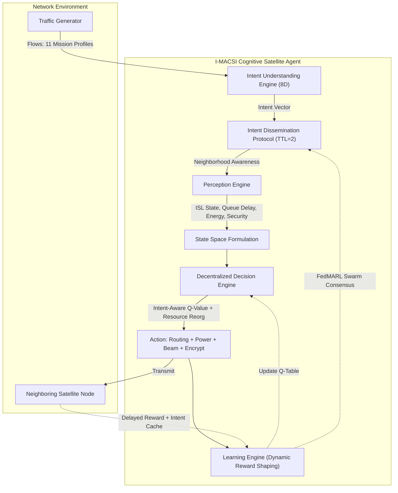

# I-MACSI: Intent-Aware Multi-Agent Cognitive Swarm Intelligence

[](file:///paper/I_MACSI_Paper.pdf)
[](https://www.python.org/downloads/)
[](file:///frontend/)
[](LICENSE)

A publication-grade simulation framework for autonomous, intent-driven self-organization in AI-native Low Earth Orbit (LEO) mega-constellation networks.

---

## Authors & Affiliation

- **Yashash Dahat**, *Graduate Student Member, IEEE*
- **Shivansh Tiwari**, *Student Member, IEEE*
- **Ayush Dehankar**, *Student Member, IEEE*
- **Akhil Gupta**, *Senior Member, IEEE* (\*Corresponding Author: `akhil.gupta@sitnagpur.siu.edu.in`)

*Department of Computer Science & Information Technology, Symbiosis Institute of Technology (SIT), Nagpur*  
*Symbiosis International (Deemed University), Pune, Maharashtra, India*

---

## Abstract

Next-generation Low Earth Orbit (LEO) mega-constellations face unprecedented challenges in dynamic routing due to high orbital velocities, frequent Inter-Satellite Link (ISL) handovers, severe radiation-induced link disruptions, and highly heterogeneous traffic demands. This repository presents **I-MACSI (Intent-Aware Multi-Agent Cognitive Swarm Intelligence)**, an autonomous self-organizing framework that shifts satellite mega-constellations from traffic-aware to mission-aware.

Every communication request is first processed by an **Intent Understanding Engine** that extracts semantic information across 8 normalized dimensions: latency sensitivity, throughput demand, delivery reliability, congestion avoidance, energy conservation, cryptographic security level, geographic coverage, and computational demand. These representations are compiled into an 8-dimensional **Mission Intent Vector (MIV)**, which is disseminated among neighboring satellites through a bounded **Intent Dissemination Protocol** (gossip-style, $TTL=2$, $<0.05\%$ optical link overhead).

Decentralized multi-agent Q-routing agents dynamically adapt Bellman reward feedback using mission-specific priority multipliers. Satellites periodically synchronize Q-tables and intent caches via federated swarm consensus (**FedMARL**, $T_{\text{sync}}=20$), followed by a post-routing joint resource optimizer governing dynamic bandwidth slicing, phased-array beam steering, space-edge compute offloading, and Earth feeder gateway selection.

---

## Expected Contributions

1. **8D Mission Intent Representation Framework**: The normalized `MissionIntentVector` mapping natural language mission descriptors into quantitative optimization constraints (`intent/mission_intent.py`).
2. **Adaptive Semantic Reward Formulation**: A dynamic `QLearningEngine` where the local Bellman equation is continuously modulated by the active mission intent and priority tier ($\pi_m \in [1, 10]$), eliminating mission starvation (`learning/q_learning.py`).
3. **Decentralized Multi-Agent Swarm Consensus**: Bounded gossip intent dissemination ($TTL=2$) (`intent/intent_dissemination.py`) and periodic FedMARL consensus learning (`learning/consensus.py`) ensuring swarm-wide regional coordination.
4. **Post-Routing Joint Resource Graph Optimizer**: Seamlessly coordinating routing paths (`routing/q_routing.py`) with dynamic bandwidth slicing, beam steering, compute task offloading, and gateway selection (`routing/graph_optimizer.py`).
5. **Comprehensive 77-Metric Empirical Benchmark**: Evaluated across $N=50$ Monte Carlo runs with 95% confidence intervals ($t_{\text{crit}} = 2.0096$), achieving +26.6% throughput at $|\mathcal{V}|=200$, -22.3% latency, 97.4% high-priority preservation, and 86.0% PDR under 30% ISL severance.

---

## Architecture Diagram



---

## Clean Repository Structure

```text
PBL-project/
├── main.py                     # Interactive swarm Q-routing simulation & failure visualizer
├── run_simulation.py           # Unified CLI simulation runner (configurable topology & intent)
├── run_all_intent_aware.py     # Batch simulation suite across all 11 mission profiles
├── backend_api.py              # Flask + WebSocket server for real-time Digital Twin telemetry
├── evaluation.py               # LEOEvaluator computing 77 QoS, mission, and system metrics
├── network_metrics.py          # Network-level graph and telemetry metrics calculator
├── config.py                   # Central configuration (orbital parameters, learning rates)
├── requirements.txt            # Python dependencies (NumPy, NetworkX, Matplotlib)
├── start.bat                   # 1-click startup launcher for Backend and 3D Frontend
├── README.md                   # Project documentation & architecture overview
├── .gitignore                  # Production Git ignore rules
│
├── agents/                     # Autonomous satellite swarm agents
│   └── satellite_agent.py      # Individual satellite node agent logic
│
├── intent/                     # Mission Intent Layer
│   ├── mission_intent.py       # 8D Mission Intent Vector & NLP keyword semantic parser
│   └── intent_dissemination.py # Bounded gossip dissemination protocol (TTL=2)
│
├── learning/                   # Multi-agent reinforcement learning core
│   ├── q_learning.py           # Tabular Bellman Q-routing with dynamic reward shaping
│   └── consensus.py            # Federated swarm consensus (FedMARL) Q-table averaging
│
├── network/                    # Physical LEO constellation topology model
│   ├── topology.py             # Walker-delta constellation mesh graph generator
│   ├── isl.py                  # Physical ISL model (propagation, M/M/1 queue, loss, energy)
│   └── isl_state.py            # ISL operational states (ACTIVE, DEGRADED, FAILED, RECOVERING)
│
├── routing/                    # Swarm routing and baseline algorithms
│   ├── q_routing.py            # Decentralized intent-aware Q-routing manager
│   ├── intent_router.py        # 8D intent-aware multi-objective link cost evaluator
│   ├── graph_optimizer.py      # Post-routing joint resource optimizer (slicing, beams, compute)
│   ├── dijkstra.py             # Shortest-path benchmark baseline
│   ├── basic_q_routing.py      # Classical unshaped Q-routing baseline
│   ├── fedmarl_baseline.py     # Standard FedMARL baseline
│   ├── ibn_sdn_baseline.py     # Centralized SDN Intent-Based Networking baseline
│   └── routing_metrics.py      # Per-hop routing telemetry and hop metrics
│
├── simulation/                 # Discrete-event simulation environment
│   ├── environment.py          # Step-based simulation environment coordinator
│   ├── traffic.py              # Multi-mission traffic generator
│   └── failure.py              # Stochastic space radiation ISL & node failure injector
│
├── visualization/              # Plotting and network graph visualization
│   ├── plotter.py              # Core simulation results visualizer
│   ├── network_visualizer.py   # 2D/3D constellation topology visualizer
│   ├── intent_plotter.py       # Intent-specific QoS and radar chart visualizer
│   └── plot_evaluation_graphs.py # Comprehensive 77-graph evaluation generator
│
├── experiments/                # Controlled empirical benchmark experiments
│   ├── baseline.py             # Comparative baseline execution suite
│   ├── failure_experiment.py   # Link severance and node blackout stress tests
│   ├── intent_experiment.py    # Multi-mission heterogeneous intent tests
│   ├── scalability_experiment.py # Mega-constellation scaling tests (20 to 200 nodes)
│   ├── convergence_experiment.py # MARL training convergence and loss tests
│   ├── ablation_study.py       # Architectural ablation of I-MACSI components
│   └── research_analysis.py    # Statistical summary analysis and reporting
│
├── results/                    # Empirical evaluation datasets & canonical figures
│   ├── figures/                # Canonical 300 DPI figures organized by research topic
│   ├── baseline_comparison.csv # Baseline evaluation data
│   ├── scalability.csv         # Scalability benchmark data
│   ├── convergence.csv         # Training convergence traces
│   ├── ablation.csv            # Ablation study results
│   ├── metrics_recorder.py     # Structured CSV telemetry recorder
│   └── analysis_report.md      # Detailed findings and conclusions
│
├── paper/                      # IEEE Transactions publication manuscript
│   ├── I_MACSI_Paper.tex       # Official IEEE Transactions two-column LaTeX source
│   ├── references.bib          # Verified IEEE Xplore bibliography (28 citations)
│   └── I_MACSI_Paper.pdf       # Compiled publication-grade 10-page IEEE PDF
│
├── docs/                       # Supplementary documentation and verification reports
│   ├── I_MACSI_Technical_Verification_and_Audit_Report.md # Full codebase audit report
│   ├── literature_review.md    # In-depth literature survey on satellite routing
│   ├── process_explanation.md  # Step-by-step algorithm and math derivation guide
│   ├── EVALUATION_GUIDE.md     # Experimental protocol & reproducibility guide
│   └── Evaluation_Graphs_List.md # Detailed index of all 77 evaluation metrics
│
├── presentation/               # Interactive briefing and slide deck
│   ├── I_MACSI_Project_Evaluation.pptx # Project evaluation slides
│   └── index.html              # HTML interactive presentation viewer
│
├── frontend/                   # 3D Digital Twin Web Dashboard (React + Vite + Three.js)
│   ├── src/                    # TypeScript components, 3D globe, and telemetry panels
│   └── package.json            # Frontend dependency definitions
│
└── scripts/                    # Maintenance & figure generation utilities
    └── generate_clean_ieee_graphs.py # Clean IEEE figure generator (de-titled, 300 DPI)
```

---

## Setup Instructions

### 1. Prerequisites
- Python 3.10+ (tested on Python 3.12 and 3.13)
- Node.js 18+ (optional, for the 3D Digital Twin frontend)

### 2. Clone and Setup Environment
```bash
git clone https://github.com/yashashdahat-dev/PBL-project.git
cd PBL-project

# Create virtual environment
python -m venv .venv
# Activate on Windows:
.venv\Scripts\activate
# Activate on Linux/macOS:
source .venv/bin/activate

# Install dependencies
pip install -r requirements.txt
```

---

## Usage Instructions

### Quick Simulation Run
```bash
# Run interactive simulation with failure injection & route recovery
python main.py

# Run CLI simulation with 64 satellites, Earth Observation intent, and 3 failures
python run_simulation.py --topology 64 --intent EARTH_OBSERVATION --failures 3 --plot

# Run the full multi-intent benchmark suite
python run_all_intent_aware.py
```

### Run Controlled Experiments
```bash
# Scalability experiment (sweeps constellation scale from 20 to 200 nodes)
python -m experiments.scalability_experiment

# ISL severance and node blackout fault tolerance
python -m experiments.failure_experiment

# Multi-mission intent classification and satisfaction
python -m experiments.intent_experiment

# Full architectural ablation study
python -m experiments.ablation_study
```

### Launch the 3D Digital Twin Dashboard
Launch both the Flask/WebSocket backend and the React 3D Digital Twin dashboard with a single command:
```bash
start.bat
```
- **Backend API**: `http://127.0.0.1:8000`
- **Telemetry WebSocket**: `ws://127.0.0.1:8001`
- **3D Web Dashboard**: `http://localhost:5173`

---

## Research Paper & Deliverables

- **IEEE Transactions Manuscript Source**: [`paper/I_MACSI_Paper.tex`](file:///paper/I_MACSI_Paper.tex)
- **Verified IEEE Xplore Bibliography**: [`paper/references.bib`](file:///paper/references.bib)
- **Compiled 10-Page IEEE Paper PDF**: [`I_MACSI_IEEE_Transactions_Research_Paper.pdf`](file:///I_MACSI_IEEE_Transactions_Research_Paper.pdf)
- **Codebase Verification & Audit Report**: [`docs/I_MACSI_Technical_Verification_and_Audit_Report.md`](file:///docs/I_MACSI_Technical_Verification_and_Audit_Report.md)
- **Canonical Evaluation Figures**: [`results/figures/`](file:///results/figures/)

---

## Citation

```bibtex
@article{dahat2026imacsi,
  author  = {Dahat, Yashash and Tiwari, Shivansh and Dehankar, Ayush and Gupta, Akhil},
  title   = {Intent-Aware Multi-Agent Cognitive Swarm Intelligence ({I-MACSI}) for Autonomous Mission-Driven Self-Organization in {AI}-Native {LEO} Mega-Constellation Networks},
  journal = {IEEE Transactions on Wireless Communications},
  volume  = {25},
  number  = {10},
  year    = {2026},
  publisher = {IEEE}
}
```

---

## License

This project is licensed under the MIT License - see the LICENSE file for details.
